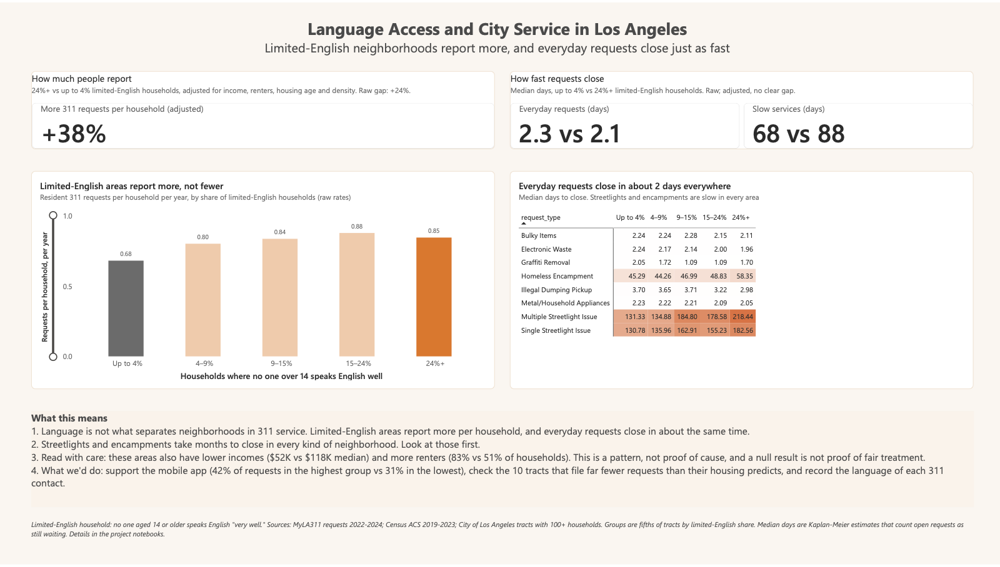

# Language Access and City Service in Los Angeles

Do Los Angeles neighborhoods with many limited-English households get slower or less city service than comparable neighborhoods? This project joins 4.1 million MyLA311 service requests (2022–2024) to Census ACS estimates by tract and tests two things: **resolution speed** and the **reporting gap**.

## Key findings

- **No resolution-speed disadvantage.** For everyday requests (bulky items, illegal dumping, graffiti, appliances, e-waste), each +10 points of limited-English household share goes with about 1% *faster* closure (95% CI: 2.4% faster to 0.05% slower). Slow services (encampments, streetlights) are slow everywhere, with no detectable difference.
- **No reporting gap at the tract level.** Limited-English tracts file *more* resident requests per household (+11% per 10 points, 95% CI +8% to +15%, adjusted for income, renter share, building age and density).
- **Channels differ.** 42% of requests in the highest limited-English quintile come through the mobile app, against 31% in the lowest.

## Dashboard

[](dashboard/LA311_dashboard.pdf)

[Download the dashboard as a PDF](dashboard/LA311_dashboard.pdf). Medians are Kaplan–Meier estimates that count open requests as still waiting.

## Recommendation

- **Don't treat language access as the main lever for faster 311 closure.** Look first at the slowest services: encampment requests take a median of about 45–58 days and streetlights about 131–218 days, with a fifth to over a third still open, in every kind of neighborhood.
- **Keep supporting the channels these residents already use,** especially the mobile app, and test whether adding languages there matters.
- **Check the 10 tracts** in the top limited-English quintile that file far fewer requests than their housing predicts, using a field visit or a community partner. This is the only way to tell fewer problems from fewer reports.
- **Collect better data:** the language of each 311 contact, administrative-closure flags and true completion dates.

## Repository contents

| Path | What it is |
|---|---|
| `notebooks/01_data_audit_and_cleaning.ipynb` | Audit the raw 311 files, flag bad rows, write `requests_clean.parquet` |
| `notebooks/02_tract_join.ipynb` | Spatial join of request points to census tracts; pick City of LA tracts |
| `notebooks/03_resolution_speed.ipynb` | Kaplan–Meier and Cox models of time to close |
| `notebooks/04_reporting_gap.ipynb` | Negative binomial model of requests per household |
| `notebooks/05_findings_and_recommendation.ipynb` | Headline numbers, robustness, Power BI extracts |
| `dashboard/` | Power BI dashboard export (PDF and preview image) |
| `scripts/pull_acs.py` | Downloads ACS 5-year tract estimates from the Census API |
| `scripts/tile_stats.py` | Median days to close by quintile (a dashboard tile) |

## Data sources

No data files are stored in this repository. Everything is public and free; the table shows where each input comes from and where it goes.

| Input | Source | Save as |
|---|---|---|
| MyLA311 Service Request Data, 2022, 2023 and 2024 | [City of Los Angeles open data portal](https://data.lacity.org) (search "MyLA311 Service Request Data"; one dataset per year; export as CSV). Check each dataset page for its license. | `data/raw/MyLA311_Service_Request_Data_2022_<date>.csv`, and the same for 2023 and 2024 (the notebook reads `MyLA311_Service_Request_Data_202*.csv`) |
| ACS 2019–2023 5-year estimates (limited-English households, income, tenure, housing age, population) | [Census API](https://api.census.gov/data/2023/acs/acs5.html), pulled by `scripts/pull_acs.py` | `data/raw/acs5_2023_la_tracts.csv` |
| Census tract boundaries, California, 2023 | [TIGER/Line `tl_2023_06_tract.zip`](https://www2.census.gov/geo/tiger/TIGER2023/TRACT/tl_2023_06_tract.zip) | unzip to `data/raw/tl_2023_06_tract/` |
| Census place boundaries, California, 2023 (City of LA outline) | [TIGER/Line `tl_2023_06_place.zip`](https://www2.census.gov/geo/tiger/TIGER2023/PLACE/tl_2023_06_place.zip) | unzip to `data/raw/tl_2023_06_place/` |

The raw 311 files are large (about 1.7 GB for three years) and contain a street address and coordinates for every request, so they are not redistributed here.

## How to reproduce

Requires Python 3.12.

```bash
# 1. Environment
python3 -m venv .venv && source .venv/bin/activate
pip install -r requirements.txt
mkdir -p data/raw data/processed

# 2. Census API key (free: https://api.census.gov/data/key_signup.html)
cp .env.example .env          # then put your key in .env

# 3. ACS estimates -> data/raw/acs5_2023_la_tracts.csv
set -a; source .env; set +a
python3 scripts/pull_acs.py 2023

# 4. Download the tract and place zips (table above), unzip them into data/raw/,
#    and put the three yearly 311 CSVs in data/raw/.
curl -L -o data/raw/tl_2023_06_tract.zip https://www2.census.gov/geo/tiger/TIGER2023/TRACT/tl_2023_06_tract.zip
curl -L -o data/raw/tl_2023_06_place.zip https://www2.census.gov/geo/tiger/TIGER2023/PLACE/tl_2023_06_place.zip
unzip -o data/raw/tl_2023_06_tract.zip -d data/raw/tl_2023_06_tract
unzip -o data/raw/tl_2023_06_place.zip -d data/raw/tl_2023_06_place

# 5. Run the notebooks in order (each reads the previous one's output)
jupyter lab notebooks/         # run 01 -> 05

# 6. Dashboard tile statistics (run from the repo root, after notebooks 01-02)
mkdir -p data/processed/powerbi_web
python3 scripts/tile_stats.py
```

The 311 files used here were downloaded on 2026-10-07. If the portal has been updated since, counts may differ slightly from the figures above.

## Regenerating the Power BI data

The dashboard reads from `data/processed/`, which is not in the repository.

- **Regenerated by the code here:** notebook 05 writes the tract table (`tracts.csv`), GeoJSON boundaries and the speed and rate tables to `data/processed/powerbi/`. `scripts/tile_stats.py` writes `data/processed/powerbi_web/tile_stats.csv`.
- **Not scripted:** the web-service extract in `data/processed/powerbi_web/` (including `LA311_powerbi.xlsx`, which adds tract centroids, quintile labels, the wide rates table and the model-results table on top of the notebook 05 outputs) was assembled by hand and has no script in this repository. To rebuild the dashboard, load the notebook 05 outputs into Power BI and recreate the model from them.

## Limitations

- Tract-level results say nothing about individual households (ecological inference).
- A null result is not proof of fair treatment. Request types, building age and department workloads explain differences in either direction, and there is no direct measure of neighborhood conditions, so "more requests" may reflect more problems.
- `ClosedDate` is when a ticket was closed, not necessarily when the work was done.
- City of LA only, 2022–2024. 2020–2021 are excluded on purpose to avoid COVID effects.
- ACS margins of error are large for small tracts, so the analysis keeps only tracts with at least 100 households.
